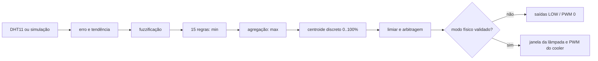

# EstufaFuzzy — controlador Mamdani de temperatura

Projeto acadêmico da disciplina **Inteligência Artificial e Sistemas
Inteligentes**, ministrada pelo professor Kleyton Hoffmann na UNOESC. O sistema
mede a temperatura de uma estufa com DHT11 e calcula comandos independentes de
aquecimento e resfriamento por lógica fuzzy Mamdani.

> **Estado de segurança:** as saídas físicas estão desabilitadas por padrão.
> `HABILITAR_SAIDAS_FISICAS` e `FIM_CURSO_VALIDADO` valem `0`. A simulação e o
> monitoramento do DHT11 funcionam, mas a lâmpada e o cooler permanecem
> desligados até a validação presencial do circuito.

## 1. Objetivo

Manter a temperatura próxima do setpoint, inicialmente **25 °C**, demonstrando
separadamente:

1. fuzzificação das entradas;
2. operadores fuzzy e ativação das 15 regras;
3. agregação Mamdani por máximo;
4. defuzzificação pelo centroide;
5. comandos numéricos de 0 a 100% para cada atuador;
6. proteções necessárias para posterior uso na estufa física.

A implementação não usa biblioteca fuzzy pronta. Toda a inferência está em
[`src/fuzzy_controller.h`](src/fuzzy_controller.h).

## 2. Hardware e pinagem preservada

| Componente | Pino | Forma de comando |
|---|---:|---|
| DHT11 | D5 | leitura digital pela biblioteca Adafruit DHT |
| Fim de curso | D4 | `INPUT_PULLUP`; polaridade ainda não validada |
| Lâmpada/SCR | D9 | comando liga/desliga por janela de 10 s, nunca PWM direto |
| Cooler | D10 | PWM de 0 a 255, com corte abaixo de 20% |

O pino do Arduino é somente um sinal lógico para o estágio de potência. Uma
carga de rede ou um motor não pode ser ligado diretamente ao microcontrolador.

## 3. Estrutura do projeto

```text
EstufaFuzzy/
├── src/
│   ├── main.cpp                 # sensor, serial, segurança e atuadores
│   └── fuzzy_controller.h       # controlador Mamdani independente do Arduino
├── testes/
│   └── test_fuzzy/test_main.cpp # testes Unity automatizados
├── scripts/
│   ├── testar.ps1               # prepara o GCC nativo e executa os testes
│   ├── simular.ps1              # compila e executa a simulação no Windows
│   └── simulador_cli.cpp        # usa o mesmo controlador do firmware
├── documentacao/
│   ├── funcoes_pertinencia.svg
│   └── resultados_simulacao.md
├── backup_professor/README.md
├── platformio.ini
└── README.md
```

O diretório `test/` é o esqueleto que já existia no projeto PlatformIO. O
diretório efetivamente configurado por `test_dir` é `testes/`.

## 4. Entradas fuzzy

As entradas são calculadas a cada amostra válida:

```text
erro      = setpoint - temperaturaAtual
tendencia = temperaturaAtual - temperaturaAnterior
```

Erro positivo significa que a estufa está abaixo do setpoint (**fria**); erro
negativo significa que está acima (**quente**). A tendência é uma diferença em
graus Celsius por amostra, e **não** uma taxa normalizada por segundo. O período
nominal entre leituras é 2,5 s. Na primeira leitura válida, a temperatura
anterior recebe o mesmo valor da atual e a tendência vale zero.

### Funções de pertinência do erro

| Conjunto | Tipo | Parâmetros em °C de erro |
|---|---|---|
| Muito quente | ombro esquerdo | 1 até −8; cai a 0 em −4 |
| Quente | triangular | (−8; −3,5; −0,5) |
| Ideal | trapezoidal | (−1; −0,4; 0,4; 1) |
| Frio | triangular | (0,5; 3,5; 8) |
| Muito frio | ombro direito | sobe de 0 em 4 a 1 em 8 |

### Funções de pertinência da tendência

| Conjunto | Tipo | Parâmetros em °C/amostra |
|---|---|---|
| Esfriando | ombro esquerdo | 1 até −0,60; cai a 0 em −0,15 |
| Estável | trapezoidal | (−0,30; −0,08; 0,08; 0,30) |
| Aquecendo | ombro direito | sobe de 0 em 0,15 a 1 em 0,60 |

As sobreposições tornam a transição gradual. Os pontos estão reunidos no
namespace `Fuzzy::Parametros` para futura calibração. Uma representação gráfica
das três variáveis está em
[`documentacao/funcoes_pertinencia.svg`](documentacao/funcoes_pertinencia.svg).

## 5. Saídas fuzzy

Aquecimento e resfriamento têm universos separados de **0 a 100%** e os mesmos
quatro conjuntos:

| Conjunto | Função no universo de saída |
|---|---|
| Desligado | ombro esquerdo de 0 a 12% |
| Fraco | triangular (5; 25; 45)% |
| Médio | triangular (30; 55; 80)% |
| Forte | ombro direito de 65 a 90%, mantendo 1 até 100% |

O centroide bruto inferior a 8% é convertido em zero. Essa zona de estabilidade
elimina a pequena área do conjunto “desligado”. Se a sobreposição das entradas
produzir dois centroides acima do limiar, a arbitragem mantém apenas o maior; se
a diferença for de até 5 pontos percentuais, ambos são desligados. Portanto, os
atuadores nunca recebem comandos simultâneos conflitantes.

## 6. Base completa de 15 regras

Cada célula mostra **aquecimento / resfriamento**. O antecedente usa o operador
E de Zadeh (`min`) e regras com o mesmo consequente são agregadas com `max`.

| Erro \ Tendência | Esfriando | Estável | Aquecendo |
|---|---|---|---|
| Muito quente | desligado / médio | desligado / forte | desligado / forte |
| Quente | desligado / fraco | desligado / médio | desligado / forte |
| Ideal | fraco / desligado | desligado / desligado | desligado / fraco |
| Frio | forte / desligado | médio / desligado | fraco / desligado |
| Muito frio | forte / desligado | forte / desligado | médio / desligado |

Assim, “muito fria e esfriando” aciona aquecimento forte; “ideal e estável”
mantém tudo desligado; e “quente e aquecendo” aciona resfriamento forte.

## 7. Inferência e defuzzificação

O caminho executado para cada amostra é:



Na defuzzificação, cada conjunto de saída é recortado pelo grau da regra. A
união usa o máximo em cada ponto inteiro de 0 a 100, e o centroide é:

```text
saida = soma(x * pertinenciaAgregada(x)) / soma(pertinenciaAgregada(x))
```

O comando `f` mostra entradas, todos os graus, regras efetivamente ativadas,
agregações, centroides brutos e saídas finais.

## 8. Monitor Serial

Abra o monitor em **9600 baud** e use:

| Comando | Ação |
|---|---|
| `h` | ajuda |
| `s` | estado, bloqueios, sensor e último cálculo |
| `x` | executa os oito cenários simulados |
| `f` | detalha o último cálculo fuzzy |
| `t 23 22` | simula temperatura atual 23 °C e anterior 22 °C |
| `p 25.5` | muda o setpoint, validado entre 15 e 35 °C |
| `r` | retorna ao modo seguro e desliga os pinos |
| `a` | solicita modo físico; permanece bloqueado na configuração entregue |

Os comandos `x` e `t` forçam o modo seguro antes de calcular. A simulação nunca
é encaminhada aos atuadores.

## 9. Compilação no VS Code/PlatformIO

1. Abra esta pasta no VS Code com a extensão PlatformIO IDE.
2. Na barra do PlatformIO, selecione o ambiente `uno`.
3. Execute **Build**. Não é necessário conectar a placa para compilar.
4. Para gravar futuramente, conecte o Uno e use **Upload**, somente após as
   verificações elétricas descritas adiante.

No terminal do PlatformIO, o equivalente é:

```powershell
platformio run -e uno
```

O firmware foi compilado neste ambiente para Arduino Uno sem erros nem avisos
relevantes. Consulte os números medidos em
[`documentacao/resultados_simulacao.md`](documentacao/resultados_simulacao.md).

## 10. Simulação e testes automatizados

No PowerShell, a suíte completa é executada com:

```powershell
.\scripts\testar.ps1
```

O script usa o ambiente `native` do PlatformIO e o MinGW declarado em
`platformio.ini`, sem depender de um GCC já instalado no PATH.

Para reproduzir os oito experimentos:

```powershell
.\scripts\simular.ps1
```

Para detalhar uma condição específica (`atual`, `anterior`, `setpoint`):

```powershell
.\scripts\simular.ps1 23 22 25
```

Na placa, `x` executa os mesmos cenários e `t` aceita valores livres. Os testes
cobrem as 15 regras, funções de pertinência, erro zero, NaN, transições,
saturação, ausência de regras e exclusão de comandos simultâneos.

## 11. Controle físico dos atuadores

### Lâmpada

A porcentagem de aquecimento define o tempo ligado dentro de uma janela não
bloqueante de 10 s. Por exemplo, 30% liga por 3 s e desliga por 7 s. É um sinal
liga/desliga destinado ao circuito de potência compatível; não é `analogWrite`
na lâmpada.

### Cooler

O percentual de resfriamento é convertido linearmente para PWM de 0 a 255.
Comandos abaixo de 20% são cortados para evitar tentativa de partida em uma
faixa inadequada. Esse mínimo deve ser medido no cooler real.

## 12. Segurança e procedimento de teste físico

Proteções implementadas:

- pinos desligados antes da inicialização do DHT11;
- duas chaves de compilação independentes mantidas em zero;
- comando explícito `a` exigido mesmo depois de habilitar as chaves;
- falha/NaN do DHT11 desativa imediatamente o modo físico;
- faixa válida de 0 °C até menos de 40 °C; ao atingir 40 °C, tudo desliga;
- fim de curso verificado continuamente quando o modo físico estiver ativo;
- simulações sempre bloqueiam o acionamento real;
- arbitragem impede aquecimento e resfriamento simultâneos;
- janela da lâmpada baseada em `millis()`, sem atrasos bloqueantes.

Procedimento presencial recomendado:

1. manter a carga de potência desconectada e verificar D5/D4/D9/D10;
2. confirmar com o professor o tipo, a polaridade e a função mecânica do fim de
   curso;
3. validar o estágio do SCR, isolamento, nível ativo e carga suportada;
4. medir a polaridade do driver e o PWM mínimo que inicia o cooler;
5. testar primeiro os sinais com carga segura e supervisão;
6. revisar o limite de 40 °C e só então alterar as duas chaves de compilação;
7. acompanhar o primeiro ensaio com `s`, `f` e um meio externo de desligamento.

## 13. Resultados e limitações

Os resultados efetivamente executados, análise qualitativa e consumo de memória
estão no [relatório de simulação](documentacao/resultados_simulacao.md). Nenhum
teste na estufa física foi alegado ou realizado neste ambiente.

Limitações conhecidas:

- DHT11 tem baixa resolução e resposta lenta; tendência por amostra pode ser
  ruidosa ou ficar vários ciclos em zero;
- parâmetros fuzzy são iniciais e precisam de calibração térmica na estufa;
- o limite de 40 °C, a faixa de setpoint e o PWM mínimo são provisórios;
- o código assume níveis ativos documentados, mas não os usa enquanto as
  chaves de segurança estiverem desabilitadas;
- um SCR para CA, um SSR e um MOSFET exigem circuitos e estratégias diferentes;
  o componente definitivo precisa ser identificado;
- não há resultados físicos de subida, acomodação, sobressinal ou perturbação.

O diretório `backup_professor/` registra a verificação dos arquivos recebidos.
Não foram encontrados arquivos-fonte originais de diagnóstico separados para
serem copiados ou modificados.
